<p align="center">
  
</p>

<p align="center">
  <a href="https://www.linkedin.com/in/vinimcorrea"></a>
  <a href="https://github.com/vinimcorrea/github-float"></a>
  <a href="https://github.com/vinimcorrea/homebrew-tap"></a>
</p>

---

### Hi! 👋

I'm a backend engineer at **[Inditex](https://github.com/inditex)**, building the distributed systems behind retail operations at scale: event-driven Java services, separate write and read models, and API contracts agreed on before the first line of code.

- 🏗️ **Building**: event-driven microservices with Spring Boot, PostgreSQL and MongoDB
- 🪟 **Also**: [GitHub Float](https://github.com/vinimcorrea/github-float), a native macOS app that keeps your team's code reviews on top of every window
- 🧪 **How I work**: tests first, small PRs, green CI
- 💬 **Ask me about**: CQRS, the outbox pattern, API-first design, and developer tools people actually keep open

### 🪟 GitHub Float

<a href="https://github.com/vinimcorrea/github-float">
  
</a>

Pull requests were sitting in review for days without anyone noticing, so I built a floating panel that makes that impossible to ignore.
Native Swift, one GraphQL query per poll, notifications only when something actually needs you.

```sh
brew install --cask vinimcorrea/tap/github-float
```

### 🛠️ Stack

<p>
  
</p>

<sub>(Java on weekdays, Swift on weekends. Deep learning studies at CU Boulder in between.)</sub>

### 📦 Before this

- **Prepaid credit payments**: a payment platform serving tens of thousands of users at 99.99% uptime
- **Text to video**: an AI tool that turns text into short-form clips for creators
- **Lab image repository**: storage and search for thousands of biology lab images
- **[Atomix](https://github.com/vinimcorrea/Atomix)**: heuristic search solving a one-player puzzle game

### 🏆 GitHub

<p align="center">
  
  
</p>

<p align="center">
  <picture>
    <source media="(prefers-color-scheme: dark)" srcset="https://raw.githubusercontent.com/vinimcorrea/vinimcorrea/output/github-snake-dark.svg">
    <source media="(prefers-color-scheme: light)" srcset="https://raw.githubusercontent.com/vinimcorrea/vinimcorrea/output/github-snake.svg">
    
  </picture>
</p>

<p align="center"><sub>Off the keyboard: jiu-jitsu, the gym and a guitar.</sub></p>
